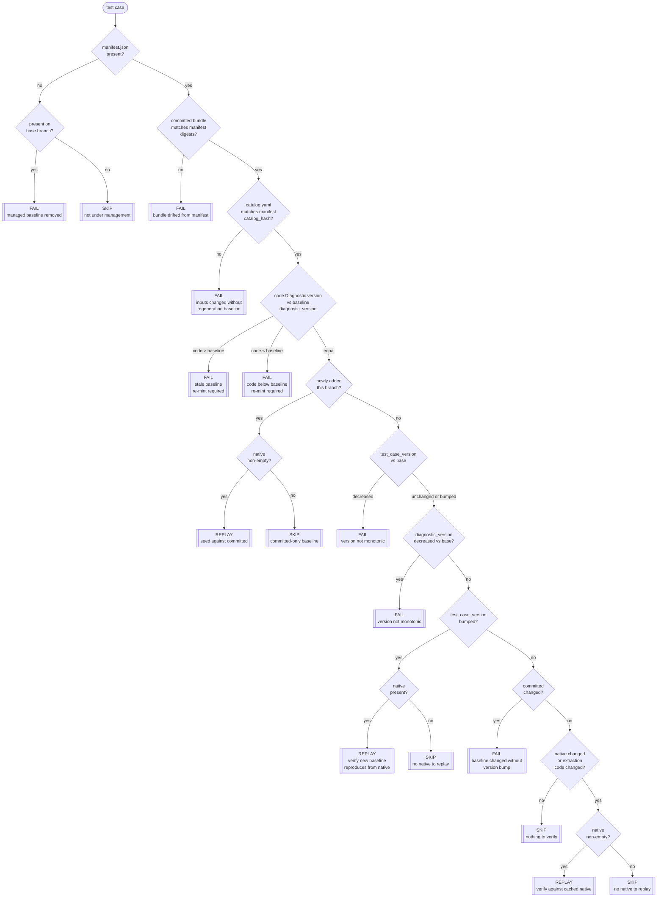

# Regression baselines and the CI coupling gate

Climate REF pins each test case to a **regression baseline**:
a recorded, known-good output that a pull request is checked against.
This stops an unintended change in a diagnostic's results from landing unnoticed.

This page covers the baseline model, the commands that produce and verify it,
and the CI coupling gate that decides how each test case is verified in a pull request.

For the day-to-day workflow see [Testing diagnostics](../how-to-guides/testing-diagnostics.md#regression-baselines).

## Why do we need baselines?

Diagnostics produce the numbers and figures that people use to evaluate climate models.
A change to a provider package, a dependency or the REF itself can shift those results
without any unit test failing.
Running every diagnostic on every change is too expensive to catch this directly.
A shifted result looks just as plausible as a correct one, so nobody notices until it has been published.
Regression testing catches this by running each test case and comparing it to a known-good output.

Doing this in CI (and in the open) is hard:

- The input data is large, far more than a runner should download on every pull request.
- Some diagnostics need more memory than GitHub-hosted runners provide.
- The outputs are large too. NetCDF files and plots are too big to keep in git.

We first tried committing decimated outputs to git.
This did not scale as the number of test cases grew and required multiple PRs to add a diagnostic.

Our testing infrastructure has to meet these requirements:

- A change to a diagnostic's results cannot land unnoticed.
- The check runs on every pull request, including from forks, without credentials or input data.
- Heavy outputs live outside git, but each baseline still records exactly which ones it expects.
- Input data is cached between runs.
- Results are machine independent and reproducible.
- A reviewer can see what changed between runs without running the diagnostic.
  Diagnostic authors and maintainers often review changes to packages they do not know well,
  so the diff has to be readable on its own.

## The two-layer baseline model

- The **committed bundle** is the small CMEC output (`series.json`, `diagnostic.json`, `output.json`)
  in the test case's `regression/` directory, tracked in git.
  Absolute paths are rewritten to placeholders (`<OUTPUT_DIR>`, `<TEST_DATA_DIR>`),
  so the bytes are machine independent.
  This bundle is the gate signal, and it is what review sees in the diff.
- The **native bundle** is the heavy output (`.nc`, `.png`, ...) that the committed bundle references.
  Native files are stored by sha256 digest in an object store and fetched anonymously.
  Only `mint` writes them, and they are never required to be present.

A `manifest.json` beside the bundle binds the two layers:

| Field                | Meaning                                                                                  |
| -------------------- | ---------------------------------------------------------------------------------------- |
| `schema`             | Manifest format version (currently `2`). A mismatch is rejected rather than misread.     |
| `test_case_version`  | Per-case integer that authorises a new committed baseline. `mint` bumps it.              |
| `diagnostic_version` | The `Diagnostic.version` captured at mint time. The author bumps it when results change. |
| `committed`          | sha256 of each committed JSON file, over the placeholder-substituted bytes on disk.      |
| `native`             | sha256 and size of each curated native file. Empty `{}` until minted.                    |
| `catalog_hash`       | Hash of the input `catalog.yaml`, coupling the baseline to its inputs.                   |

Both version fields are monotonic and may never decrease.

!!! note "An empty native set is a valid state"
    Fork contributors cannot mint, because minting needs object-store write credentials.
    A baseline with `native: {}` is still gated by its committed bundle.
    The native layer adds replay verification when the blobs exist.

## Lifecycle commands

The `ref test-cases` verbs produce and verify baselines.
Only `mint` needs write credentials, so everything else is safe on untrusted code.

| Verb | Credentials | What it does |
| --- | --- | --- |
| `run` | none | Executes the diagnostic (or reuses the slot's native with `--from-slot`) and rebuilds the committed bundle. Promotes it to `regression/` only on first seed or with `--force-regen`, keeping the existing `test_case_version` and native block. |
| `mint` | write | Executes (or replays the stored native with `--from-replay`), uploads changed native blobs and rewrites the manifest. Bumps `test_case_version` when the committed bundle changed. Usually run by CI. |
| `replay` | public read | Fetches the native baseline, re-runs only `build_execution_result` and compares the result to the committed bundle. |

`run` warns, but never blocks, when a promoted bundle's native digests differ from the minted baseline.
This means a re-mint is needed.

### Output slots

Every `run`, `replay` and `mint` writes what it produced into a gitignored output slot
at `<test case>/output/<label>/`.
The slot holds the curated native files, and the rebuilt committed bundle under `regression/`.

`--label` names the slot.
The default `latest` is overwritten each time, but named slots persist,
so `run --label before`, a code change, then `run --label after` gives two slots to diff.

## Comparing results

Floats in the committed bundle are rounded to 7 significant figures when written.
This keeps the bytes stable across machines, so a local run and a CI mint produce the same diff.

`replay` takes a byte-equal fast path first.
Otherwise it sanitises volatile values to placeholders and compares numbers with `math.isclose` at `rtol=1e-5`.
That tolerance is two digits coarser than the rounding, so rounding can never flip a verdict.

## The CI coupling gate

`decide_coupling` decides how to verify each test case from the head and base manifests,
plus three on-disk facts:

- `extraction_changed`: any file under the diagnostic's provider package or the core regression package changed.
  This is a path heuristic, so it cannot tell an execution change from an extraction change.
- `committed_integrity_ok`: the committed bundle on disk still matches `manifest.committed`.
- `catalog_integrity_ok`: the input catalog still matches `manifest.catalog_hash`.

Changed files come from `base...HEAD`, so churn on the base branch is ignored.

`diagnostic_version` covers the gap that `extraction_changed` leaves.
An execution change with no extraction-path edit (the [#671](https://github.com/Climate-REF/climate-ref/issues/671) ECS case) would otherwise replay green against a stale bundle.
The gate fails any baseline whose `diagnostic_version` no longer matches the in-code `Diagnostic.version`.

The gate returns one of three actions:

- **`skip`**: nothing relevant changed, the case is not under regression management,
  or the committed bundle changed with no native baseline to replay against, so review of the diff is the only check.
- **`replay`**: re-check against the cached native baseline. Only chosen when native blobs exist.
- **`fail`**: an unauthorised or unverifiable change.

The gate fails closed: any state it cannot verify is a `fail`.
The only exception is a missing native baseline, which is legitimate and downgrades to `skip` with a warning.



`ref test-cases ci-gate` exits non-zero if any case is `fail`.
Its `--json` output drives the `replay` jobs in CI.

## Continuous integration

Four workflows run the lifecycle.
Minting needs credentials, and this is a public repository,
so `mint` runs only on a trusted runner and never on fork pull-request code.

| Workflow | Trigger | Credentials | What it does |
| --- | --- | --- | --- |
| `regression-pr-gate.yaml` | every pull request | none | Runs the gate, then `replay`s every case it routes to `replay`. |
| `regression-mint.yaml` | manual dispatch | R2 write (baselines bucket) | `mint`s baselines and commits the result back to the branch. |
| `regression-diff-report.yaml` | called by mint, or manual | R2 write (reports bucket) | Builds an HTML diff of the changed baselines and links it on the PR. |
| `regression-drift.yaml` | nightly, or manual | none | `replay`s every baseline to catch silent drift, eg. after a dependency upgrade. |

### PR gate

The gate job runs `ref test-cases ci-gate --json` against the base branch on `ubuntu-latest` with no secrets.
`fail` aborts the job, `replay` cases are verified against the public native baseline,
and `skip` cases are left to review of the diff.
It downloads no input datasets, only the native blobs for the cases it replays.

Reproduce a pull request's verdict locally with the same script:

```bash
make regression-gate                          # against origin/main
bash scripts/ci/regression-pr-gate.sh main    # or any base ref
```

### Gated mint

The mint workflow is dispatched by hand on the feature branch that should receive the new baseline,
and is gated behind the `native-baselines` GitHub Environment.
It refuses to run on the default branch.
It commits the regenerated bundle and `manifest.json` back to the branch,
so the change is reviewed in its pull request and no developer needs write credentials.

| Input          | Meaning                                                                                                    |
| -------------- | ---------------------------------------------------------------------------------------------------------- |
| `provider`     | Provider slug to mint.                                                                                     |
| `diagnostic`   | One or more diagnostic slugs, separated by commas or spaces. Blank mints every diagnostic of the provider. |
| `test_case`    | A single test case. Rejected when more than one diagnostic is given.                                       |
| `bump_version` | Always bump `test_case_version`, even if the committed bundle did not change.                              |
| `dry_run`      | Preview without uploading or committing.                                                                   |

One job mints all the requested diagnostics, so a single environment approval covers them.
Fetches run serially, because the runners share an `intake-esgf` cache backed by SQLite.
A failing diagnostic does not stop the others.
The successful ones are committed together, then the job fails and names the ones that did not mint.
After pushing, the job calls `regression-diff-report.yaml`.

!!! warning "The mint commit does not re-trigger the PR gate"
    The push uses `GITHUB_TOKEN`, and GitHub does not start workflows for those pushes.
    Push a follow-up commit, or re-run the PR gate from the Actions tab, to replay-verify the new baseline.

!!! note "Required repository configuration"
    Create a `native-baselines` Environment with required reviewers,
    holding an object-scoped R2 token as two secrets:

    - `R2_ACCESS_KEY_ID` -> `REF_NATIVE_STORE_ACCESS_KEY_ID`
    - `R2_SECRET_ACCESS_KEY` -> `REF_NATIVE_STORE_SECRET_ACCESS_KEY`

    `REF_NATIVE_STORE_S3_ENDPOINT_URL` and `REF_NATIVE_STORE_BUCKET` override the production defaults.

### Diff report

The diff report covers every test case whose baseline changed against the base branch:

- Images are shown old beside new.
- Text files and committed bundle files get a coloured line diff.
  Committed files are marked "in PR", because they also appear in the pull request's file list.
- A changed NetCDF gets a header diff and per-variable statistics, shaded where values moved.
- Each case page lists its full baseline folder, including unchanged files.

The report is served at `https://reports.baselines.climate-ref.org/<pr>/<sha>/index.html`
and linked in a comment on the branch's open pull request, or in the job log if there is none.

After minting locally and pushing by hand, dispatch the report yourself.
It can also be built locally without credentials:

```bash
gh workflow run regression-diff-report.yaml --ref <branch>
uv run ref test-cases diff --base origin/main --html-dir out/
```

!!! note "Required repository configuration"
    The workflow needs an R2 user with read/write access to the reports bucket:

    - `R2_REPORTS_ACCESS_KEY_ID` -> `REF_REPORT_STORE_ACCESS_KEY_ID`
    - `R2_REPORTS_SECRET_ACCESS_KEY` -> `REF_REPORT_STORE_SECRET_ACCESS_KEY`

    `REF_REPORT_STORE_S3_ENDPOINT_URL`, `REF_REPORT_STORE_BUCKET` and `REF_REPORT_STORE_URL` override the defaults.
