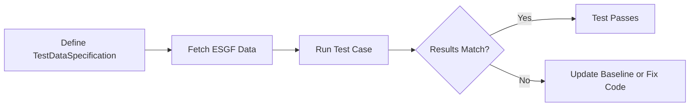

# Testing Diagnostics

This guide explains how to set up reproducible tests for your diagnostic provider package.
The testing infrastructure allows you to define `test cases`.

Each `test case` describes an execution of a diagnostic with specific datasets.
The test infrastructure takes care of fetching data from ESGF, running the diagnostic execution and,
tracking the outputs as regression tests.

## Overview

### Aim

The REF supports many diagnostics across multiple provider packages,
each with different data requirements.
Rather than maintaining a single monolithic test dataset that contains everything every diagnostic might need,
the testing infrastructure allows:

- **Diagnostic-controlled test data**:
    Each diagnostic declares exactly which datasets it needs for testing via `test_data_spec`.
    This keeps test data minimal and focused.

- **Selective fetching**: Developers only need to download test data for the diagnostics they're working on, not the entire test suite.
    This saves disk space and download time.

- **Independent testing**: Updates to a diagnostic's data requirements don't impact other diagnostics results.
    This makes it easier to contribute new diagnostics.

- **Reproducible results**: By pinning specific ESGF datasets (source, experiment, time range),
  tests produce consistent results across different machines and CI environments.

/// note
The [ref-sample-data](https://github.com/Climate-REF/ref-sample-data) repository
represents the original monolithic approach - a centrally managed collection of decimated test datasets for all diagnostics.
While this worked for the first round of diagnostics,
it requires coordination to add new test data and updating the sample data often lead to impacts for other diagnostics.

An alternative approach was required that was easier to maintain ([#472](https://github.com/Climate-REF/climate-ref/issues/472)).
///

### Workflow

The testing workflow consists of:

1. **Define test data specifications** in your diagnostic class
2. **Fetch test data** from ESGF using CLI commands
3. **Run test cases** via CLI or pytest
4. **Compare results** against regression baselines



## Defining Test Data Specifications

Each diagnostic defines a `test_data_spec` attribute that declares exactly which datasets it needs for testing.
The specification contains one or more independent test cases.
Each test case represents the data needed for a single execution.

When a test case runs, only those specific datasets are used -
the test infrastructure filters out any other data that may be present.
This ensures reproducible test execution regardless of what other data exists locally.

### Basic Structure

```python
from climate_ref_core.testing import TestDataSpecification, TestCase
from climate_ref_core.esgf import CMIP6Request, Obs4MIPsRequest

class MyDiagnostic(Diagnostic):
    name = "My Diagnostic"
    slug = "my-diagnostic"

    # ... data_requirements and other attributes ...

    test_data_spec = TestDataSpecification(
        test_cases=(
            TestCase(
                name="default",
                description="Standard test with historical data",
                requests=(
                    CMIP6Request(
                        slug="test-tas",
                        facets={
                            "source_id": "ACCESS-ESM1-5",
                            "experiment_id": "historical",
                            "variable_id": "tas",
                            "member_id": "r1i1p1f1",
                            "table_id": "Amon",
                        },
                    ),
                ),
            ),
        ),
    )
```

### TestCase Attributes

| Attribute       | Type                      | Description                                                    |
| --------------- | ------------------------- | -------------------------------------------------------------- |
| `name`          | `str`                     | Unique identifier (e.g., `"default"`, `"edge-case"`)           |
| `description`   | `str`                     | Human-readable description of the test scenario                |
| `requests`      | `tuple[ESGFRequest, ...]` | ESGF requests to fetch the required datasets for the test case |
| `datasets_file` | `str \| None`             | Path to a pre-built catalog YAML file (relative to package)    |

### ESGF Requests

Each test case declares the set of data that is required from ESGF.
Only datasets resolved by these requests will be available when using the test case.

ESGF's [Metagrid](https://esgf-node.ornl.gov/) can be used to explore the results from applying different facet filters.

#### CMIP6Request

For CMIP6 model output:

```python
from climate_ref_core.esgf import CMIP6Request

CMIP6Request(
    slug="unique-identifier",
    facets={
        "source_id": "ACCESS-ESM1-5",      # Model name
        "experiment_id": "historical",      # Experiment
        "variable_id": "tas",               # Variable
        "member_id": "r1i1p1f1",           # Ensemble member
        "table_id": "Amon",                # MIP table (frequency)
        "grid_label": "gn",                # Optional: grid type
    },
    time_span=("2000-01", "2014-12"),  # Optional: YYYY-MM format
    remove_ensembles=False,             # Keep all ensemble members
)
```

#### Obs4MIPsRequest

For observational datasets:

```python
from climate_ref_core.esgf import Obs4MIPsRequest

Obs4MIPsRequest(
    slug="obs-tas",
    facets={
        "source_id": "ERA5",
        "variable_id": "tas",
        "frequency": "mon",
    },
)
```

#### CMIP7Request

For CMIP7 data published on ESGF:

```python
from climate_ref_core.esgf import CMIP7Request

CMIP7Request(
    slug="cmip7-tas",
    facets={
        "source_id": "UKESM1-3-LL",
        "experiment_id": "historical",
        "variable_id": "tas",
        "branding_suffix": "tavg-h2m-hxy-u",
        "frequency": "mon",
    },
    remove_ensembles=True,
)
```

CMIP7 data is only in the ESGF STAC indices (`discovery.east.esgf.io` and `discovery.west.esgf.io`).
Recent intake-esgf releases enable them by default.
An older `~/.config/intake-esgf/conf.yaml` may not list them, and a warning is shown.

#### ConvertedCMIP7Request

Not every model and variable has CMIP7 data on ESGF yet,
so `ConvertedCMIP7Request` fabricates it from CMIP6.
It maps CMIP7 facets to CMIP6 ones (eg. `variant_label` -> `member_id`),
fetches the CMIP6 files and converts them on the fly.
It will be removed once every test case can use published data.

```python
from climate_ref_core.esgf import ConvertedCMIP7Request

ConvertedCMIP7Request(
    slug="cmip7-tas",
    facets={
        "source_id": "ACCESS-ESM1-5",
        "experiment_id": "historical",
        "variable_id": "tas",
        "variant_label": "r1i1p1f1",   # CMIP7 name, mapped to member_id internally
        "table_id": "Amon",
    },
)
```

Converted files are cached in `cmip7-converted/` under `$REF_DATASET_CACHE_DIR`,
or under the user cache directory at `climate_ref/cmip7-converted/` when that is unset.
Clear it by hand if a conversion produces stale output.

To move a test case to published data, swap its `ConvertedCMIP7Request` for a `CMIP7Request`.
ESGF does not know the converted datasets in the existing catalog,
so run `ref test-cases fetch --regen` to resolve the new request, then re-mint the baselines.

### Dataset Resolution

A `TestCase` resolves its datasets via one of two mechanisms:

- **`datasets_file`**: If set, datasets are loaded directly from the specified YAML file.
  Use this when you have pre-built catalog data at a known location
  or when you need precise, machine-independent control over which files are used.
- **Solve from catalog**: If `datasets_file` is not set, the test runner uses `requests`
  to filter and solve datasets from the local catalog (populated by `ref test-cases fetch`).

Only datasets resolved by the active mechanism are visible during the test run,
ensuring reproducible execution regardless of what other data is present locally.

### Using a Datasets File

For complex test cases or when you need precise control over dataset paths,
you can specify datasets via a YAML file:

```python
TestCase(
    name="from-file",
    description="Test case loading datasets from YAML",
    datasets_file="test_datasets/my_diagnostic.yaml",
)
```

The YAML file follows the same structure used by the data catalog:

```yaml
# test_datasets/my_diagnostic.yaml
cmip6:
  slug_column: instance_id
  selector:
    source_id: ACCESS-ESM1-5
    member_id: r1i1p1f1
  datasets:
    - instance_id: CMIP6.CMIP.CSIRO.ACCESS-ESM1-5.historical.r1i1p1f1.Amon.tas.gn.v20191115
      path: /path/to/tas_Amon_ACCESS-ESM1-5_historical_r1i1p1f1_gn_200001-201412.nc
      variable_id: tas
      table_id: Amon
      source_id: ACCESS-ESM1-5
      experiment_id: historical
      member_id: r1i1p1f1
      grid_label: gn
      version: v20191115
    - instance_id: CMIP6.CMIP.CSIRO.ACCESS-ESM1-5.historical.r1i1p1f1.fx.areacella.gn.v20191115
      path: /path/to/areacella_fx_ACCESS-ESM1-5_historical_r1i1p1f1_gn.nc
      variable_id: areacella
      table_id: fx
      source_id: ACCESS-ESM1-5
      experiment_id: historical
      member_id: r1i1p1f1
      grid_label: gn
      version: v20191115
```

This approach is useful when:

- You have pre-existing test data in specific locations
- You need to test against local modifications of datasets
- You want to test a specific edgecase

## CLI Commands

### Listing Test Cases

View all available test cases:

```bash
ref test-cases list
ref test-cases list --provider ilamb
```

### Fetching Test Data

Download ESGF data for your test cases:

```bash
# Fetch all test data
ref test-cases fetch

# Fetch for a specific provider
ref test-cases fetch --provider my-provider

# Fetch for a specific diagnostic
ref test-cases fetch --provider my-provider --diagnostic my-diagnostic

# Dry run (show what would be fetched)
ref test-cases fetch --dry-run

# Fetch and run a test case in one step
ref test-cases run --provider my-provider --diagnostic my-diagnostic --fetch
```

When data is fetched, it is stored in intake-esgf's cache directory and a catalog YAML file
is saved to track the resolved datasets.
Test data is stored within each provider package using a diagnostic-first structure:

```raw
packages/climate-ref-{provider}/tests/test-data/
└── {diagnostic}/
    └── {test_case}/
        ├── catalog.yaml           # Dataset metadata (tracked in git)
        ├── manifest.json          # Baseline metadata (written by `run`/`mint`)
        └── regression/            # Committed baseline bundle (tracked in git)
            ├── series.json
            ├── diagnostic.json
            └── output.json
```

The catalog is split into two files, which live in different places:

- **`catalog.yaml`**: Contains dataset metadata (instance IDs, facets, selectors).
It sits beside the test case, is version-controlled, and is portable across machines.
- **`catalog.paths.yaml`**: Contains the local file path for each dataset.
It lives under the dataset cache, at
`$REF_DATASET_CACHE_DIR/test-case-paths/{provider}/{diagnostic}/{test_case}/`.

The paths it records are machine-specific.
They point into the caches that hold the data, mostly the intake-esgf cache and the dataset cache,
so the sidecar belongs with those caches rather than with a checkout.
This means it is shared by every checkout on the machine,
and a fresh checkout cannot lose it.
`ref test-cases fetch` refreshes it after each successful fetch, even when the catalog
metadata is unchanged. This repairs partial path maps and paths to old cache locations.
The fetch, run and mint commands and the no-drift tests check that every catalog row
resolves to an existing file before running a diagnostic.

CI uses `ref test-cases fetch --strict`. It attempts all selected cases and returns a
non-zero exit status if any cannot be resolved. It also rejects changes to catalog
content that a downstream job's fresh checkout would not receive. Regenerate and review
the affected catalogs and baselines before committing them. Changes only to the stored
catalog hash or dataset row order do not trigger this check.

Provider test jobs set `REF_TEST_CASES_STRICT=true` so missing catalogs or committed
baselines fail instead of becoming silent skips. Explicit `REF_TEST_CASES_SKIP`
diagnostic exclusions still apply. Local test runs retain the default skip behaviour.

The CMIP7 test cases for `transient-climate-response-emissions` and
`zero-emission-commitment` have been removed from their test specifications.
The current fetcher converts CMIP6 data and cannot supply the required `esm-flat10`
and `esm-flat10-zec` experiments. CMIP6 cases and the diagnostics' CMIP7 support
remain enabled. Restore the CMIP7 cases when valid experiment inputs and reviewed
baselines are available. Do not relabel CMIP6 experiments to stand in for them.

#### Data Caching

The `ref test-cases fetch` command uses [intake-esgf](https://github.com/esgf2-us/intake-esgf)
to download datasets from ESGF if they cannot be found locally.
`intake-esgf` supports a two-tier cache system configured via `~/.config/intake-esgf/conf.yaml`:

- **`esg_dataroot`**: Paths checked FIRST for existing data (read-only). Ideal for institutional ESGF mirrors or shared drives.
- **`local_cache`**: Where new downloads are stored if not found in `esg_dataroot`.

The fetch command saves a catalog YAML file that records the paths to these files,
so subsequent test runs can locate the data without re-scanning directories.

Cached CMIP7 conversions are checked before reuse, and any invalid file is rebuilt.

/// Note | Using shared ESGF data (HPC/shared drives)

On HPC systems, point `esg_dataroot` at an existing shared CMIP6 archive so intake-esgf
reuses it instead of re-downloading; new files still go to `local_cache`:

```yaml
# ~/.config/intake-esgf/conf.yaml
esg_dataroot:
  - /shared/cmip6/data      # Read-only institutional mirror, checked first
local_cache:
  - /scratch/$USER/.esgf    # New downloads land here
```

See the [intake-esgf documentation](https://github.com/esgf2-us/intake-esgf) for more options.
///

### Running Test Cases

Execute a test case:

```bash
# Run the default test case
ref test-cases run --provider my-provider --diagnostic my-diagnostic

# Run a specific test case
ref test-cases run --provider my-provider --diagnostic my-diagnostic --test-case edge-case

# Specify output directory
ref test-cases run --provider my-provider --diagnostic my-diagnostic --output-directory ./output

# Regenerate regression baseline
ref test-cases run --provider my-provider --diagnostic my-diagnostic --force-regen
```

## Pytest Integration

### The generated per-provider test

Every provider package wires its test cases into pytest with a single line in
`tests/integration/test_diagnostics.py`:

```python
from climate_ref_example import provider

from climate_ref.testing import create_no_drift_test

test_run_test_cases = create_no_drift_test(provider)
```

`create_no_drift_test` generates one parameterized pytest case per test case,
identified as `{diagnostic}/{test_case}` and marked `slow` and `test_cases`.
Each case re-executes the diagnostic against the fetched catalog
using the same execute/build stages as `ref test-cases run`,
then asserts the freshly rebuilt committed bundle
matches the tracked `regression/` baseline within tolerance.
Cases are skipped when the fetched catalog or the committed baseline is missing,
so the suite stays green for contributors who haven't fetched data for that provider.

Run them with the `--slow` flag:

```bash
# All test cases for a provider
uv run pytest packages/climate-ref-example/tests/integration/test_diagnostics.py --slow

# A single test case, selected by its id
uv run pytest --slow \
    "packages/climate-ref-example/tests/integration/test_diagnostics.py::test_run_test_cases[global-mean-timeseries/default]"
```

### Writing custom tests

For behaviour the standard drift check doesn't cover,
run a test case directly with `TestCaseRunner`.
The `config` fixture (an isolated per-test configuration)
comes from the `climate_ref.conftest_plugin` pytest plugin,
which is auto-discovered when `climate-ref` is installed.

```python
import pytest
from my_provider import provider

from climate_ref.testing import TestCaseRunner
from climate_ref_core.testing import TestCasePaths, load_datasets_from_yaml


@pytest.mark.slow
def test_my_diagnostic(config, tmp_path):
    diagnostic = provider.get("my-diagnostic")
    diagnostic.provider.configure(config)

    paths = TestCasePaths.from_diagnostic(diagnostic, "default")
    if paths is None or not paths.catalog.exists():
        pytest.skip("Test data not fetched; run `ref test-cases fetch` first")

    runner = TestCaseRunner(config=config, datasets=load_datasets_from_yaml(paths.catalog))
    result = runner.run(diagnostic, "default", output_dir=tmp_path / "output")

    assert result.successful
```

### Markers

Mark custom tests so they run in the right CI tier:

```python
@pytest.mark.slow
def test_full_resolution(config):
    """Test with full-resolution ESGF data (slow)."""
    ...

@pytest.mark.requires_esgf_data
def test_requires_fetched_data(config):
    """Test that requires fetched ESGF data."""
    ...
```

Run specific test categories:

```bash
# Include slow tests
pytest --slow

# Only the generated test-case drift tests
pytest --slow -m test_cases

# Skip tests requiring ESGF data
pytest -m "not requires_esgf_data"
```

## Regression baselines

Diagnostics are slow, so CI does not re-run them on every pull request.
Each test case is instead pinned to a regression baseline:
a recorded set of results that a pull request must still reproduce.
See [Regression baselines](../background/regression-baselines.md) for how CI checks this.

### Terms

| Term | Meaning |
| --- | --- |
| Committed bundle | The small JSON results in `regression/` (`series.json`, `diagnostic.json`, `output.json`). These are in git, so reviewers see your numbers change in the diff. |
| Native files | The heavy outputs (`.nc`, `.png`, ...) that the JSON refers to. These are kept in shared storage, not in git. |
| `manifest.json` | A record of which committed and native files belong to the baseline, plus two version numbers. It is in git. |
| Mint | Upload the native files and record them in `manifest.json`. Only a maintainer can mint. |
| Replay | Rebuild the committed bundle from the stored native files, without re-running the diagnostic, and compare. |
| Output slot | A gitignored folder, `output/latest/` by default, where every run puts what it produced so you can inspect it. |

### Adding a test case

1. Define the test case and fetch its data (see [Fetching Test Data](#fetching-test-data)).
2. Run it:

   ```bash
   ref test-cases run --provider my-provider --diagnostic my-diagnostic --test-case my-case
   ```

   The first run creates `regression/` and `manifest.json`.
3. Check the numbers in `regression/` look right.
   CI cannot check them yet, so you and the reviewer are the only check.
4. Commit `catalog.yaml`, `manifest.json` and `regression/`, then open a pull request.
   The PR gate shows `skip` for the new case.
5. Ask a maintainer in the pull request to mint the baseline.
   Afterwards the CI checks if the baseline is available.

### Changing a diagnostic's results

1. Bump `version` on your diagnostic class.
   It is an integer that starts at `1`.
   Bump it for algorithm changes, bug fixes or data requirement changes that alter the results.
   A new `version` will trigger all existing executions to be recalculated.

   ```python
   class MyDiagnostic(Diagnostic):
       version = 2
   ```

2. Check the new results locally with `ref test-cases run`.
   This writes them to the output slot, so compare them with the old baseline:

   ```bash
   cd packages/climate-ref-my-provider/tests/test-data/my-diagnostic/default
   git diff --no-index regression/ output/latest/regression/
   ```

3. Commit your code change, but not changes to `regression/` or `manifest.json`.
   The PR gate fails at this point, because the baseline is older than your `version`.
   This is expected.
4. Ask a maintainer in the pull request to mint.
   The mint reruns the diagnostic, commits the new `regression/` and `manifest.json` to the branch,
   and posts a report comparing the old and new outputs.
5. Push any follow-up commit so the PR gate runs again and replays the new baseline.

Do not commit a baseline from `run --force-regen` when you are going to mint.
`mint` bumps `test_case_version` only when its bundle differs from the committed one,
so a pre-committed bundle leaves the version unbumped and the gate fails.

`run` warns about any `regression/` file over `--size-threshold` (default 1.0 MB).
Keep committed files small, because large outputs belong in the native files.

### For maintainers: minting

Dispatch the **"Regression baselines (mint)"** workflow from the Actions tab on the pull request's branch.
The workflow only runs on branches in `Climate-REF/climate-ref`,
so a pull request from a fork needs its branch pushed to the repository first.
Its inputs and configuration are described in [Gated mint](../background/regression-baselines.md#gated-mint).

### What the PR gate says

| Outcome | Meaning | What to do |
| --- | --- | --- |
| **skip** | Nothing relevant changed, or there are no native files to replay yet. | Nothing. For a new or changed baseline, check the diff yourself. |
| **replay** | CI rebuilt the committed bundle from the stored native files and it matched. | Nothing. If it does not match, your change moved the results, so follow [Changing a diagnostic's results](#changing-a-diagnostics-results). |
| **fail** | The baseline does not match the code, eg. `version` was bumped but nothing was minted, or `regression/` was edited without a version bump. | Ask a maintainer to mint, or revert the change to `regression/`. |

Run the same gate locally with `make regression-gate`, which compares against `origin/main`.

## Troubleshooting

### Common Errors

| Error                    | Cause                              | Solution                          |
| ------------------------ | ---------------------------------- | --------------------------------- |
| `NoTestDataSpecError`    | Diagnostic has no `test_data_spec` | Add `test_data_spec` attribute    |
| `TestCaseNotFoundError`  | Invalid test case name             | Check `test_data_spec.case_names` |
| `DatasetResolutionError` | Missing test data                  | Run `ref test-cases fetch`        |
| `No datasets found`      | ESGF query returned empty          | Check facets are correct          |

### Debugging Tips

1. **List available test cases**:

   ```bash
   ref test-cases list --provider my-provider
   ```

2. **Check fetched data catalogs**:

   ```bash
   # List test case directories for a provider
   ls packages/climate-ref-my-provider/tests/test-data/

   # View catalog metadata for a test case
   cat packages/climate-ref-my-provider/tests/test-data/my-diagnostic/default/catalog.yaml

   # View local paths (if exists); the sidecar lives under the dataset cache
   cat "${REF_DATASET_CACHE_DIR:-$(uv run python -c 'import pooch; print(pooch.os_cache("climate_ref"))')}"/test-case-paths/my-provider/my-diagnostic/default/catalog.paths.yaml
   ```

3. **Run with verbose logging**:

   ```bash
   ref --verbose test-cases run --provider my-provider --diagnostic my-diagnostic
   ```

4. **Debug path resolution**:

   If catalogs aren't being written, enable debug logging to see how paths are resolved:

   ```bash
   LOGURU_LEVEL=DEBUG ref test-cases fetch --provider my-provider --diagnostic my-diagnostic
   ```

   The logs will show:
   - Which provider module is being looked up
   - Whether the `tests/` directory exists (required for dev checkout detection)
   - The derived test data directory path
   - Whether catalogs/regression directories are being created

### Debugging a failing test case

When a pytest drift test (or the CI replay gate) reports that a committed bundle has drifted,
the fastest loop is usually through the CLI rather than pytest,
because the outputs stay in a predictable place.

1. **Re-run the test case via the CLI** and inspect what it produced:

   ```bash
   ref --verbose test-cases run --provider my-provider --diagnostic my-diagnostic
   ```

   Every run repopulates the gitignored `output/latest/` slot in the test case directory
   with the executed native files and, under `output/latest/regression/`,
   the rebuilt committed bundle.
   Pass `--output-directory ./scratch` to also keep the raw execution directory
   (logs, intermediate files) somewhere convenient.

2. **Diff the rebuilt bundle against the tracked baseline**:

   ```bash
   cd packages/climate-ref-my-provider/tests/test-data/my-diagnostic/default
   git diff --no-index regression/ output/latest/regression/
   ```

   The drift assertion also prints a per-file summary of what moved beyond tolerance.

3. **Compare two runs side by side** using named output slots.
   `latest` is overwritten on every run, but a named slot persists:

   ```bash
   ref test-cases run ... --label before
   # ... change the code ...
   ref test-cases run ... --label after
   diff -r .../output/before/regression .../output/after/regression
   ```

4. **Separate "my code changed the results" from "the baseline is stale"** with
   `ref test-cases replay --provider my-provider`.

   Replay rebuilds the bundle from the stored native baseline without executing the diagnostic.
   If replay passes but `run` drifts, your change moved the results.
   If replay also fails, the committed baseline itself is inconsistent, so re-mint it.

5. **Debug through pytest** when you need a debugger at the point of failure:

   ```bash
   uv run pytest --slow --pdb \
       "packages/climate-ref-my-provider/tests/integration/test_diagnostics.py::test_run_test_cases[my-diagnostic/default]"
   ```

   The pytest run works in the test's `tmp_path`
   (retained for the most recent runs under `/tmp/pytest-of-<user>/`):
   the execution directory is `exec/` and the rebuilt bundle is `slot/regression/`.

## Other useful links

- [Adding Custom Diagnostics](adding_custom_diagnostics.md)
- [Running Diagnostics Locally](running-diagnostics-locally.py)
- [Dataset Selection](dataset-selection.py)
